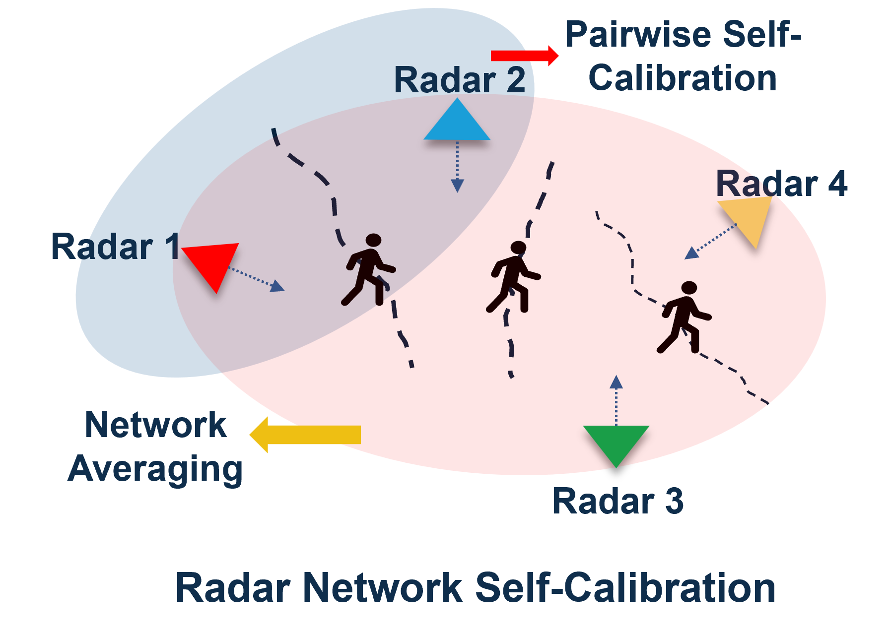

# 5. First run and calibration

## Start the network

1. Make sure the fusion center stack is up (`docker compose ps`) and every
   node's `netradar-node` service is running.
2. Open the dashboard: `http://<fusion-center-name>:5002`. Each configured node
   should show as **online**.
3. Under **Node Control**, press **F** (initialise the radar and DCA1000) and
   then **▶** (start the pipeline) for each node. Within about 10 s the nodes
   receive a time-sync tick and begin capturing on the shared trigger schedule;
   their detections and tracks appear on the bird's-eye plot. Until you
   calibrate, each node is drawn in its own coordinates (see
   [Dashboard](dashboard.md)).

## Calibrate

Each node reports targets in its own coordinate frame. Self-calibration
estimates every node's position and heading relative to the others, so that all
detections land in one shared frame.

1. Place the radars so that their fields of view **overlap**.
2. Have **one person walk** through the shared area — single-target frames give
   the cleanest calibration.
3. In the dashboard's **Calibration** panel, set *Frames* (default 150) and
   press **Start Calibration**. The fusion center collects the next
   batch of live frames from every node, solves pairwise calibrations
   (RANSAC-robust closed form) and averages them over the network.
4. The result is published to the nodes and shown on the dashboard. Repeat if a
   node is moved.

<figure markdown="span">
  { width="600" loading=lazy }
  <figcaption>What calibration needs: overlapping fields of view and people moving through them.</figcaption>
</figure>

An example result, from the outdoor deployment on the [home page](index.md#see-it-in-action):

<figure markdown="span">
  { width="700" loading=lazy }
  <figcaption>Before calibration each radar's tracks are in its own coordinates; afterwards the radars' positions and orientations are known and the same people line up across radars.</figcaption>
</figure>

The method is described in our papers — see [Citing NetRadar](citing.md).

## Where the data goes

Every live frame (clusters, tracks and the CFAR detections behind each cluster),
every command and every calibration result is stored in PostgreSQL on the fusion
center:

```bash
docker compose exec postgres psql -U netradar -d netradar
```

The schema and an example query are in the
[NetRadar-FusionCenter README](https://github.com/NetRadar-Testbed/NetRadar-FusionCenter#database).
